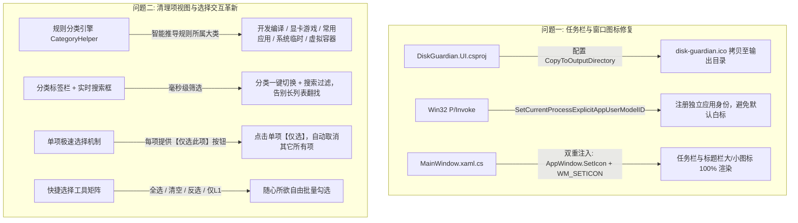

# 实施计划 - 任务栏图标修复与清理项视图选择重构

解决用户反馈的两大痛点：
1. **任务栏图标缺失**：程序运行后在 Windows 任务栏显示为系统默认无图标白方块；
2. **清理项选择与视图问题**：只能全选或L1，单选某一项需要逐个取消勾选极其麻烦；平铺列表项过多、缺乏分类和搜索、翻找费劲。

---

## 一、方案架构设计

---

## 二、拟改动文件清单

1. `src/DiskGuardian.UI/DiskGuardian.UI.csproj`：
   - 添加 `disk-guardian.ico` 输出拷贝配置；
2. `src/DiskGuardian.UI/MainWindow.xaml.cs`：
   - 引入 `SetCurrentProcessExplicitAppUserModelID`；
   - 强化 Win32 原生 `WM_SETICON`（`ICON_BIG` 与 `ICON_SMALL`）以及 `AppWindow.SetIcon` 双重兜底；
3. `src/DiskGuardian.UI/ViewModels/CleanerRuleRow.cs`：
   - 增加分类（Category）推断与分类徽章属性；
   - 增加单项【仅选此项】指令或事件通知；
4. `src/DiskGuardian.UI/Views/CleanerPage.xaml`：
   - 顶部工具栏重构：分类筛选标签组（Segmented/Pivot/Chips）+ 实时搜索框（AutoSuggestBox / TextBox）；
   - 快捷勾选工具条：【仅选推荐(L1)】、【全选】、【反选】、【清空(全部取消)】；
   - 规则行卡片设计升级：新增【仅选】快速操作按钮、分类图标徽章、视觉层次升级；
5. `src/DiskGuardian.UI/Views/CleanerPage.xaml.cs`：
   - 实现分类过滤与实时搜索联动逻辑；
   - 实现【仅选此项】、【反选】等操作逻辑；
6. `README.md` / `README_EN.md`：
   - 更新清理模块与界面交互说明。

---

## 三、验证与测试规划
1. **任务栏图标验证**：
   - 编译生成运行，检查 Windows 任务栏是否准确显示盾牌/磁盘图标，彻底告别默认空白方块；
2. **清理项选择验证**：
   - 点击任何一项的【仅选】，验证是否仅该项被选中，其它所有项全部取消；
   - 点击【清空】，验证所有项全部取消勾选；
   - 点击【反选】，验证勾选状态瞬间翻转；
3. **分类与搜索验证**：
   - 点击“显卡游戏”，验证是否仅显示 NVIDIA 着色器项；
   - 输入“微信”，验证是否毫秒级过滤出微信缓存规则。
