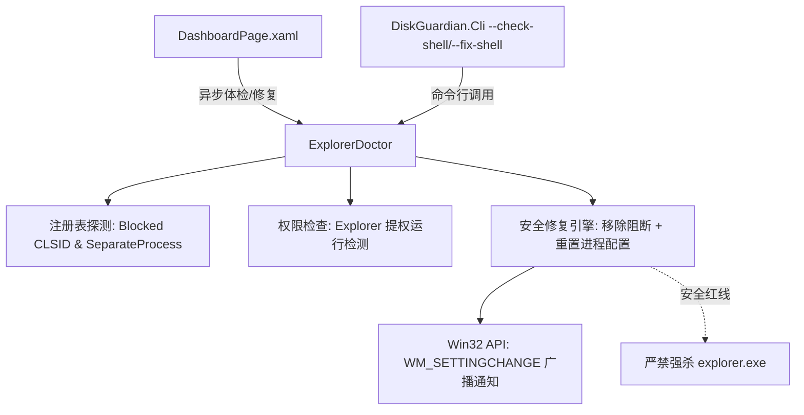

# ExplorerDoctor（系统外壳与资源管理器健康守护）实施计划

## 1. 背景与目标
解决用户在 Windows 11 下因注册表篡改、进程隔离策略冲突或权限提权而导致资源管理器“现代多标签页与 Fluent 界面”丢失、意外降级回退至 Windows 10 经典 Ribbon 界面的问题。将其正式集成进 `DiskGuardian` 套件，与 `ProxyDoctor` 共同组成系统级健康诊断双核。

## 2. 核心架构与设计

### 关键检测项与修复逻辑
1. **现代命令栏阻断 (`CLSID {e2bf9676-5f8f-435c-97eb-11607a5bedf7}`)**：
   - 检测 `HKCU` 与 `HKLM` 下的 `\SOFTWARE\Microsoft\Windows\CurrentVersion\Shell Extensions\Blocked`；
   - 修复：安全移除对应的屏蔽项。
2. **独立进程冲突 (`SeparateProcess`)**：
   - 检测 `HKCU\Software\Microsoft\Windows\CurrentVersion\Explorer\Advanced\SeparateProcess`；
   - 若为 `1`，Win11 无法复用多标签页宿主，导致窗口降级为 Win10 Ribbon 界面；
   - 修复：一键重置为 `0`。
3. **Explorer 运行权限感知**：
   - 探测系统 `explorer.exe` 是否在提权状态下运行，给出针对性建议。
4. **零破坏与桌面安全守则**：
   - 严禁调用 `taskkill /F /IM explorer.exe`，防止 DeskBox 与桌面微件崩溃坍塌；
   - 采用 Win32 API `SendMessageTimeoutW` 广播 `WM_SETTINGCHANGE` 刷新外壳环境。

## 3. 任务清单
- [ ] 编写 `src/DiskGuardian.Core/Diagnostics/ExplorerDoctor.cs`
- [ ] 编写 `DiskGuardian.Cli` 命令行扩展（`--check-shell` / `--fix-shell`）
- [ ] 重构 `src/DiskGuardian.UI/Views/DashboardPage.xaml` 与 `DashboardPage.xaml.cs`，嵌入 ExplorerDoctor 卡片
- [ ] 编译验证与端到端测试（Core 编译、UI 编译、CLI 运行）
