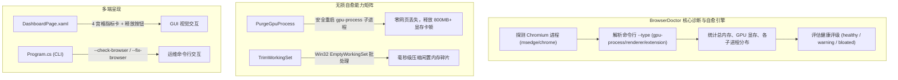

# 实施计划 - 浏览器性能与显存医生 (BrowserDoctor)

## 一、需求背景与目标
针对用户反馈的“Edge 浏览器忽然变卡、内存飙升至 3.5GB、GPU 进程膨胀近 900MB”等实际痛点，在 DiskGuardian 中深度集成 **BrowserDoctor (浏览器健康与性能医生)**，为 Windows 桌面用户提供免关网页、零数据丢失的无损性能自愈能力。

---

## 二、架构与技术方案

---

## 三、文件改动计划
1. **核心库**：新建 `src/DiskGuardian.Core/Diagnostics/BrowserDoctor.cs`
   - 进程类型识别、内存与 CPU 汇总；
   - `PurgeGpuProcess`：精准定位 `--type=gpu-process` 并执行安全无损重启；
   - `TrimWorkingSet`：P/Invoke `psapi.dll!EmptyWorkingSet`，批量压缩物理内存；
2. **UI 仪表盘**：修改 `src/DiskGuardian.UI/Views/DashboardPage.xaml` 与 `DashboardPage.xaml.cs`
   - 新增【🌐 浏览器性能与显存医生 (BrowserDoctor)】卡片；
   - 4 宫格核心指标：运行实例、总内存开销、GPU 显存开销、健康评级；
   - 一键自愈操作：【⚡ 释放 GPU 显存】、【🧹 压缩闲置内存】、【重新体检】；
   - 展开区展示高占用进程 Top 5；
3. **CLI 运维端**：修改 `src/DiskGuardian.Cli/Program.cs`
   - 增加 `--check-browser` 与 `--fix-browser` 指令；
4. **测试与文档**：
   - 全量编译 0 警告 0 错误；
   - 更新任务看板与验证报告；
   - **严格遵守约定**：本地修改自检完成后向用户汇报，**绝不擅自发包**！
