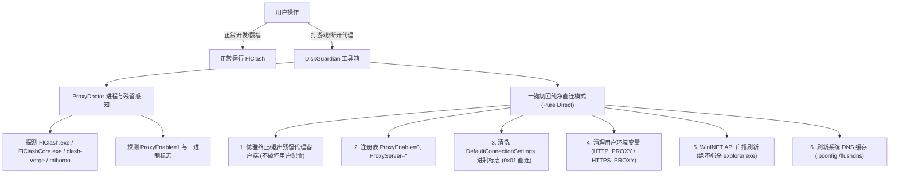

# 代理退出残留净化与纯净直连模式 (Pure Direct / Game Mode) 实施计划

## 1. 用户痛点与背景
用户日常正常使用 FlClash（科学上网与 AI 开发）。但在需要退出 FlClash 打游戏时，由于：
1. FlClash 点击右上角 X 默认仅最小化到托盘，未真正退出；
2. FlClash 安装了后台 Windows 服务（`FlClashHelperService` / `FlClashCore.exe`），后台常驻运行；
3. FlClash 退出时未重置注册表 `ProxyEnable=0`，系统代理死死指向 `127.0.0.1:7890`，导致游戏被注入代理或防作弊拦截；
4. DiskGuardian 现有 ProxyDoctor 看到 7890 正在监听，误判为“正常活跃代理”，缺乏“一键强力切断代理、彻底清空残留”的主动直连功能。

## 2. 核心架构设计

## 3. 具体实现步骤
1. **Core 层 (`ProxyDoctor.cs`)**：
   - 增加代理客户端进程与系统服务探测（`DetectProxyProcesses()`）；
   - 在 `ProxyDiagnosisResult` 中增加 `RunningProxyProcesses` 字段；
   - 编写 `SwitchToPureDirect(bool terminateProxyClients, ...)` 方法，支持一键清空代理、终止残留、广播刷新与 DNS flush，并严格保护用户配置与订阅文件不被删除；
2. **UI 仪表盘 (`DashboardPage.xaml` & `DashboardPage.xaml.cs`)**：
   - 仪表盘 ProxyDoctor 顶部控制栏增加醒目的 **【🎮 切换纯净直连 (打游戏/彻底无残留)】** 按钮；
   - 在 4 宫格或状态栏展示当前检测到的后台代理客户端（例如 `FlClash.exe (PID: 2444) 托盘常驻`）；
   - 点击切换直连时弹出确认框（可勾选是否同时终止后台 FlClash 托盘进程），执行后即时刷新；
3. **CLI 命令行 (`Program.cs`)**：
   - 增加 `--direct` / `--force-direct` 参数，支持终端一键切回纯净直连；
4. **编译验证与全套测试**：
   - Core / Cli / UI 编译验证；
   - 21 项安全自测 100% 通过；
5. **为用户提供清晰指导**：
   - 告知用户 FlClash 客户端内部的“防残留配置”（关闭按钮行为设置为退出应用）；
   - 告知用户如何使用新功能一键切断代理无缝打游戏。
