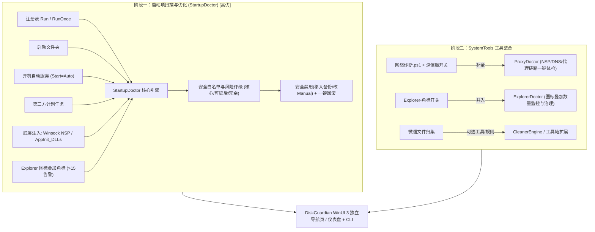

# 实施计划 - 启动项优化引擎 (StartupDoctor) 与 SystemTools 工具整合

## 一、背景与目标
当前 `C:\Users\36230\SystemTools` 目录下分散着多套日常排障与维护工具（`扫启动项.ps1`、`网络诊断.ps1`、`Explorer-角标开关`、`深信服开关`、`微信文件归集`、`2FA-Vault` 等），缺乏统一的 WinUI 3 入口与安全基线联动。

本阶段目标：
1. **优先落地「启动项优化与驻留瘦身引擎 (`StartupDoctor`)」**：完整吸收 `SystemTools\扫启动项.ps1` 的 8 维扫描能力，增加分类评级、安全禁用/恢复与开机拖慢项治理（不误杀代理 `FlClash`、硬件驱动 `PawnIO` 与核心安全服务）；
2. **逐步整合 `SystemTools` 常用能力进 `DiskGuardian`**：形成“空间清理 + 硬件/网络/外壳/浏览器/启动项全能系统守护中心”。

---

## 二、整体架构与整合路线图

---

## 三、阶段一详细设计：`StartupDoctor`（启动项优化）

### 1. 核心引擎 (`src/DiskGuardian.Core/Diagnostics/StartupDoctor.cs`)
吸收 `C:\Users\36230\SystemTools\扫启动项.ps1` 的 8 大扫描面并工程化：
- **普通自启层**：`HKLM/HKCU`（含 `WOW6432Node`）的 `Run / RunOnce`、用户/公共启动文件夹；
- **系统服务与计划任务层**：所有 `StartMode = Auto` 的非微软第三方服务、以及 `Ready` 状态的非微软计划任务；
- **隐藏钩子与注入层（极易拖慢全系统，常规清理软件不管）**：
  - `Winsock2\Parameters\Namespace_Catalog5` 第三方 NSP；
  - `AppInit_DLLs` 与 `LoadAppInit_DLLs`；
  - `ShellIconOverlayIdentifiers`（超过 15 个即标黄预警拖慢资源管理器）。
- **安全护栏（Hard Guard）**：
  - 严禁禁用系统核心服务、显卡/芯片组/PawnIO 驱动、以及当前网络代理（`FlClash` / `127.0.0.1:7890` 相关）和输入法服务；
  - 所有“禁用”操作均保留原状态快照（支持一键恢复原状），注册表启动项可采用 Windows 原生 `StartupApproved\Run` 禁用标记而非直接删除键值。

### 2. UI 与 CLI 呈现
- **WinUI 3**：在左侧导航栏新增 **「🚀 启动项治理」** 独立页面（或在仪表盘设摘要卡 + 跳转），支持按【全部 / 常规自启 / 后台服务 / 计划任务 / 底层注入与角标】筛选、一键禁用高占用非必要项、一键回滚；
- **CLI**：新增 `--check-startup`（输出结构化 8 维启动项体检报告）与 `--optimize-startup`（仅预览或按安全策略建议）。

---

## 四、阶段二：`SystemTools` 其余工具整合规划
1. **网络诊断 & 深信服开关** → 并入 `ProxyDoctor`：补齐 DNS 连通性、路由表、WinHTTP/WinINET 及第三方 VPN/NSP 残留一键检测（严禁自动切断正在使用的科学上网代理）。
2. **Explorer 角标开关** → 并入 `ExplorerDoctor`：复用 `ShellIconOverlayIdentifiers` 扫描结果，可视化展示并支持清理冗余网盘/Git 图标叠加占坑。
3. **快捷工具直达区**：对于独立工具（如 `2FA-Vault`、`微信文件归集`），可在 DiskGuardian 的「工具箱」或快捷入口中直接挂载唤起，告别桌面/目录翻找。
