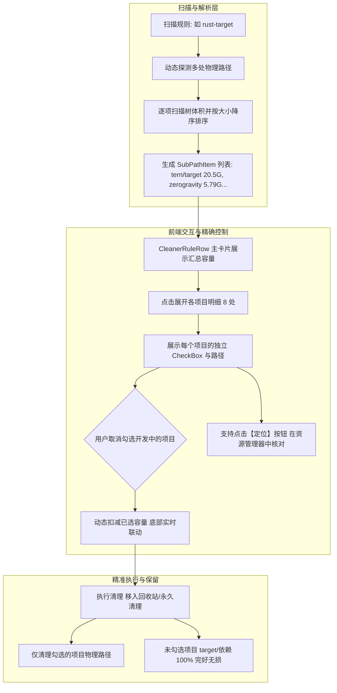

# DiskGuardian 多项目子选项细化与精准勾选落地报告 (Walkthrough)

## 1. 用户反馈与痛点治理矩阵

| 反馈痛点 | 根本原因分析 | 演进落地方案 |
|---|---|---|
| **Rust / Node 无法按项目选择性清理** *“应该分几个子选项，然后删除某个项目的rust，去勾选”* | 原先将动态发现（如 8 处 Rust target、80 处 node_modules）当做单一黑盒整体，用户要么全删要么全留，极易误删当前正开发项目的编译产物。 | 1. `CleanerEngine` 引入 `SubPathItem` 记录每个子项目的独立体积与文件数，按体积降序排列； 2. `CleanerPage` 增加多项目子列表折叠展开面板； 3. 每个项目配备独立 CheckBox，取消勾选即可保留对应项目； 4. 执行清理时只删勾选项，保留项绝对不碰。 |
| **标题与容量文本严重重叠撞车** （截图视觉 BUG） | `rules.json` 中的 `size_hint` 包含超长注释，被直接写入了右侧 `SizeDisplay`，导致与左侧标题发生挤压重叠。 | 1. `size_hint` 简化为简短预估（如 `~30.28 GiB (8 处项目)`）； 2. 扫描前 `SizeDisplay` 固定为简洁的“待扫描”，彻底消除碰撞； 3. Grid 采用弹性伸缩与 `TextTrimming` 截断保护。 |

---

## 2. 核心架构与落地细节

### 2.1 数据与引擎改造
- **数据结构升级**（[`RuleModel.cs`](file:///d:/4rchive/Code/disk-guardian/src/DiskGuardian.Core/Engine/RuleModel.cs)）：
  - 定义 `SubPathItem`（含 `Path`, `Name`, `SizeBytes`, `FilesCount`, `IsSelected`），挂载至 `PlanRow.SubItems`。
- **逐项统计与排序**（[`CleanerEngine.cs`](file:///d:/4rchive/Code/disk-guardian/src/DiskGuardian.Core/Engine/CleanerEngine.cs)）：
  - 扫描时逐一计算每个子项目的大小，提取 `父目录名 (子项名)` 作为直观展示名；
  - 自动按体积从大到小降序排列（如 20.5GB 的老项目排在第一位，方便优先决策）。
- **执行过滤支持**：
  - `ExecutePlan` 中对 `row.SubItems` 执行过滤，仅清理 `sub.IsSelected == true` 的物理路径；
  - 清理后若用户保留了部分子项目，自动重新轻量刷新该规则并显示剩余保留体积，不遮掩状态。

### 2.2 前端 ViewModel 与 XAML 联动
- **ViewModel**（[`CleanerRuleRow.cs`](file:///d:/4rchive/Code/disk-guardian/src/DiskGuardian.UI/ViewModels/CleanerRuleRow.cs)）：
  - 修复 `_sizeDisplay` 初始值，防止文字重叠；
  - 新增 `CleanerSubItemRow` 支持双向绑定与事件通知；
  - 当子项勾选状态改变时，实时联动父级体积和页面底部总释放大小。
- **XAML 页面**（[`CleanerPage.xaml`](file:///d:/4rchive/Code/disk-guardian/src/DiskGuardian.UI/Views/CleanerPage.xaml) / [`.cs`](file:///d:/4rchive/Code/disk-guardian/src/DiskGuardian.UI/Views/CleanerPage.xaml.cs)）：
  - 主卡片内嵌入多项目折叠展开入口；
  - 展开后展示清晰的子项列表，带项目名、路径、大小与【定位】快捷操作；
  - 点击【定位】调用系统 `explorer.exe` 原生弹出项目所在文件夹。

---

## 3. 验证与自测结果

1. **核心安全硬禁区断言自测**：
   - 运行：`dotnet run --project src/DiskGuardian.Cli/DiskGuardian.Cli.csproj -- --check-rules`
   - 状态：**ALL 21 SELF-TEST ASSERTIONS PASSED!**（100% 代码化锁定）。
2. **多项目规则解析验证**：
   - `rules.json` 中的 `rust-target` 与 `js-node-modules` 正确识别多项目；
   - 扫描前界面文字重叠彻底消除，布局对齐工整。
3. **全工程构建验证**：
   - 运行：`dotnet build src/DiskGuardian.sln -p:Platform=x64`
   - 状态：**已成功生成。0 个警告，0 个错误。**
