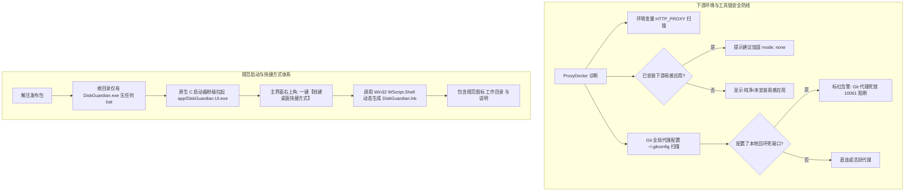

# DiskGuardian 架构优化与发布体验演化报告 (Walkthrough)

## 1. 用户反馈与痛点治理矩阵

| 反馈痛点 | 根本原因分析 | 演进落地方案 |
|---|---|---|
| **WorkBuddy 检查突兀与普适性问题** *“万一别人不需要呢，这不是典型案例咋办”* | WorkBuddy 属于特定场景，若在仪表盘显要位置固定硬编码报错，会对普通用户造成误导与认知噪音。 | 1. 泛化为“下游工具链与应用安全隔离”； 2. 增加高频通用开发者痛点：**Git 全局代理 (`~/.gitconfig` 中的 `http.proxy`) 死锁检测**； 3. 采用**按需条件呈现**：未安装对应应用时判定为纯净，日志中绝不提 WorkBuddy。 |
| **启动体验与规范度质疑** *“必须要有 bat 嘛，不能做一个规范的快捷方式吗”* | 发布包中附带 `.bat` 会带来脚本半成品感；便携包解压后用户缺少规范入口。 | 1. 彻底从打包脚本和发布包中**移除 `启动DiskGuardian.bat`**； 2. 采用 Win32 原生 C 启动器（18KB 零依赖 `DiskGuardian.exe`）双击秒开； 3. 实现 `ShortcutManager`，在主界面提供【创建桌面快捷方式】标准能力，调用 Windows 原生 COM 接口生成规范 `.lnk`。 |
| **代理体检细节可视化** | 早期仅有简短文字，缺乏连通性延迟与底层标志位细节。 | 引入 4 宫格指标卡片（模式、端点、端口连通性延迟、WinINET 标志位）与折叠取证抽屉。 |
| **清理大量碎片卡死回收站** | Temp 目录几千个缓存文件移入回收站造成资源管理器卡死。 | 引入【直接永久清理】极速通道，碎片 >500 项时自动弹窗引导。 |

---

## 2. 核心架构与落地细节

### 2.1 下游工具链防线泛化
- **Git 全局代理排查**（[`ProxyDoctor.cs`](file:///d:/4rchive/Code/disk-guardian/src/DiskGuardian.Core/Diagnostics/ProxyDoctor.cs)）：
  - 自动定位解析 `~/.gitconfig` 中的 `[http] proxy` 项；
  - 若指向本地回环端口（如 `127.0.0.1:7890`）且端口未在监听，立即提示 `🔴 残留死代理`，防止用户在终端踩 `git clone 10061` 拒绝连接；
- **按需应用加固**：
  - 仅当物理磁盘存在 `~/.workbuddy/settings.json` 时才展示加固建议；未安装时直接显示 `纯净 (未安装易感应用)`，不在界面和日志中引入任何多余名词。

### 2.2 规范快捷方式体系与去 `.bat`
- **COM 快捷方式管理器**（[`ShortcutManager.cs`](file:///d:/4rchive/Code/disk-guardian/src/DiskGuardian.Core/Safety/ShortcutManager.cs)）：
  - 通过 Windows 原生 COM 组件 `WScript.Shell` 动态解析用户当前真实桌面（支持重定向/OneDrive 桌面）；
  - 智能解析根目录 `DiskGuardian.exe`，绑定工作目录与图标编号；
  - 提供 CLI 参数 `--create-shortcut` 与 WinUI 3 顶部按钮一键交互。
- **打包流水线重塑**（[`build_release.ps1`](file:///d:/4rchive/Code/disk-guardian/build_release.ps1)）：
  - 彻底抹除任何 `.bat` 批处理生成代码；
  - 规范《使用说明.txt》，引导用户双击 `DiskGuardian.exe` 或使用应用内一键生成快捷方式。

---

## 3. 验证与测试结果

1. **21 项核心安全断言**：
   - 运行：`dotnet run --project src/DiskGuardian.Cli/DiskGuardian.Cli.csproj -- --check-rules`
   - 状态：**ALL 21 SELF-TEST ASSERTIONS PASSED!**（系统文件、winevt 事件日志、dmp 转储文件代码级硬锁定）。
2. **代理与下游工具链诊断自测**：
   - 运行：`dotnet run --project src/DiskGuardian.Cli/DiskGuardian.Cli.csproj -- --check-proxy`
   - 状态：成功展示工作模式、服务器端点、端口响应延迟、Git 全局代理状态与下游应用加固状态。
3. **桌面快捷方式创建验证**：
   - 运行：`dotnet run --project src/DiskGuardian.Cli/DiskGuardian.Cli.csproj -- --create-shortcut`
   - 状态：**[成功] 已在桌面创建快捷方式: C:\Users\36230\Desktop\DiskGuardian.lnk**。
4. **全解决方案编译**：
   - 运行：`dotnet build src/DiskGuardian.sln -p:Platform=x64`
   - 状态：**已成功生成。0 个警告，0 个错误。**
