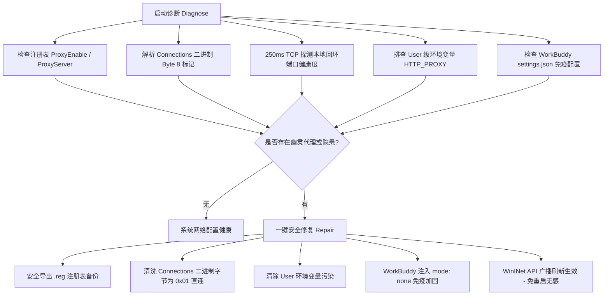

# ProxyDoctor 幽灵代理诊断与安全修复实施报告 (Walkthrough)

## 1. 需求与问题背景
当用户使用代理软件（如 FlClash、Clash Verge）并在非正常退出或卸载时，WinINET 注册表通常会出现“表面关闭、深层残留”的幽灵状态：
- **注册表 DWORD**：`HKCU\...\Internet Settings\ProxyEnable` 显示为 `0`（关闭）。
- **二进制脏数据**：`HKCU\...\Internet Settings\Connections` 下的 `DefaultConnectionSettings` 与 `SavedLegacySettings` 二进制数据中，第 8 字节 flags 仍残留 `0x02` 或 `0x03`，且保存着 `127.0.0.1:7890` 等端口。
- **环境污染扩散**：Electron 框架应用（如 WorkBuddy、Cursor 等）启动时通过底层库读取二进制设置，误以为代理已开启，便主动注入 `HTTP_PROXY="http://127.0.0.1:7890"` 到主进程和子进程环境变量中。
- **最终后果**：由于本地没有监听该端口的代理服务，终端工具链（git、curl、npm、Claude Code）所有网络请求均被强行丢向死端口，报 `actively refused (10061)` 瘫痪。

## 2. 解决方案与核心架构

遵循 C.T.I.V. 流程与 Windows 桌面环境安全规范（严禁杀死 `explorer.exe`），在 `DiskGuardian` 中实现了纯原生 C# 的诊断与修复引擎：



### 核心亮点
1. **纯 C# 原生实现，零第三方依赖**：
   - 核心文件位于 [`DiskGuardian.Core/Diagnostics/ProxyDoctor.cs`](file:///d:/4rchive/Code/disk-guardian/src/DiskGuardian.Core/Diagnostics/ProxyDoctor.cs)。
2. **符合桌面安全准则（`windows_desktop_safety.md`）**：
   - 使用 WinINet 原生 API `InternetSetOptionW`（常量 `39=INTERNET_OPTION_SETTINGS_CHANGED`, `37=INTERNET_OPTION_REFRESH`）向系统广播代理配置更新。
   - **绝对不杀 `explorer.exe`**，不破坏任何基于 WinUI 3 / WPF 的桌面微件与 Shell 窗口。
3. **安全第一：预修备份**：
   - 在动注册表前自动调用 Windows 原生 `reg export` 导出备份至 `out/proxy_backup_<timestamp>.reg`。
4. **彻底治本与防御加固**：
   - 修复二进制配置中的 flags（清除 `0x02` 位，强制置 `0x01` 直连模式），同时将序列号递增防缓存。
   - 自动在 `~/.workbuddy/settings.json` 中配置 `"mode": "none"`，彻底切断 Electron 误读系统代理的通道。

---

## 3. CLI 与 WinUI 3 落地

### 3.1 CLI 命令行工具
通过 `DiskGuardian.Cli` 提供极简运维指令：
- **诊断**：`DiskGuardian.Cli.exe --check-proxy`
  - 自动输出代理状态报告与隐患告警。
  - 存在异常时以 exit code 1 返回，健康时返回 0，可无缝接入 CI 或定时脚本。
- **修复**：`DiskGuardian.Cli.exe --fix-proxy`
  - 自动完成备份、注册表修复、广播刷新与 WorkBuddy 配置加固。

### 3.2 WinUI 3 原生 Fluent 桌面界面
在 [`DashboardPage.xaml`](file:///d:/4rchive/Code/disk-guardian/src/DiskGuardian.UI/Views/DashboardPage.xaml) 新增“网络与幽灵代理体检”卡片：
- **实时状态感知**：页面加载时异步体检，用 Fluent 图标（ShieldCheckmark 绿色 / DismissCircle 红色 / Warning 橙色）指示状态。
- **一键安全修复**：点击【一键安全修复】弹出 Fluent 对话框，二次确认后异步执行，实时输出修复步骤日志与备份路径。

---

## 4. 验证结果

1. **项目整体编译**：
   ```powershell
   dotnet build src/DiskGuardian.UI/DiskGuardian.UI.csproj -c Release -p:Platform=x64 -r win-x64
   ```
   输出：**0 警告，0 错误**。

2. **引擎 21 项安全自测**：
   ```powershell
   dotnet run --project src/DiskGuardian.Cli/DiskGuardian.Cli.csproj -- --check-rules
   ```
   输出：**ALL 21 SELF-TEST ASSERTIONS PASSED!**（原有规则与安全机制无任何破坏）。

3. **CLI 实机诊断测试**：
   ```powershell
   dotnet run --project src/DiskGuardian.Cli/DiskGuardian.Cli.csproj -- --check-proxy
   ```
   输出：成功探测并精准识别系统当前的代理状态与 WorkBuddy 的潜在风险项。
