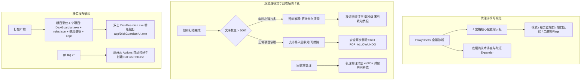

# DiskGuardian 体验与发布三大痛点改造实施报告 (Walkthrough)

## 1. 用户反馈痛点与解决矩阵

| 体验痛点 | 根本原因 | 改造落地方案 |
|---|---|---|
| **痛点 1: 代理体检细节不够直观** | 仅显示一两行摘要，无法看清代理模式、端口连通性延迟、PAC、注册表 Flags 与环境变量 | 1. `ProxyDoctor` 扩展工作模式、延迟探测、二进制标志位解析、绕过列表等维度； 2. `DashboardPage` 新增 4 宫格 Fluent 指标卡片（模式、服务器、端口健康度、Flags）与折叠取证抽屉； 3. CLI `--check-proxy` 格式化层次输出。 |
| **痛点 2: 发布包 177 个文件散乱难找** | WinUI 3 unpackaged 模式平铺所有 WindowsAppSDK 与 .NET 库；无自动 Release 流水线 | 1. 增加纯 C# 轻量启动器 `DiskGuardian.Launcher` 生成根目录 `DiskGuardian.exe`； 2. 打包结构将 170+ 依赖收纳于 `app/` 目录，去除 `.pdb`；解压后仅保留启动器与规则； 3. GitHub Actions 增加 Tag 自动发布 GitHub Release 工作流。 |
| **痛点 3: 移入回收站卡死、塞入几千个文件** | 对 Temp/DXCache 纯临时碎片强行移入回收站，产生几千个 `$I/$R` 导致 Windows 资源管理器假死 | 1. `CleanerEngine` 引入 `permanent` 极速物理清理； 2. `CleanerPage` 提供双模式按钮（【移入回收站】与【直接永久清理】）； 3. 碎片 >500 项时智能弹窗推荐极速模式； 4. `RecycleManager` 调优毫秒级批量物理清空。 |

---

## 2. 核心架构与详细落地

### 2.1 代理详情可视化与排查增强
- **核心文件**：[`DiskGuardian.Core/Diagnostics/ProxyDoctor.cs`](file:///d:/4rchive/Code/disk-guardian/src/DiskGuardian.Core/Diagnostics/ProxyDoctor.cs)
  - 增加 `TestPort(host, port)` 测算本地回环握手响应延迟（如 19ms）。
  - 解析 `DefaultConnectionSettings` 第 8 字节（如 `0x03 (直连+手动代理)`、`0x01 (直连)`）。
  - 读取 `ProxyOverride` 绕过名单与 `AutoConfigURL` PAC 脚本地址。
  - 用户环境变量污染排查与 WorkBuddy 防线状态。
- **WinUI 3 仪表盘**：[`DashboardPage.xaml`](file:///d:/4rchive/Code/disk-guardian/src/DiskGuardian.UI/Views/DashboardPage.xaml)
  - 顶部指标：当前工作模式、服务器与端口、本地端口状态、WinINET 标志位。
  - 折叠面板：可展开查看全量底层取证数据与日志。

### 2.2 极简发布架构与 GitHub Release 自动化
- **启动器设计**：[`DiskGuardian.Launcher`](file:///d:/4rchive/Code/disk-guardian/src/DiskGuardian.Launcher/Program.cs)
  - 纯原生 WinExe，只有 150 KB，无黑框。
  - 运行时启动 `app/DiskGuardian.UI.exe` 并保持目录上下文。
- **CI / 本地脚本**：[`.github/workflows/build.yml`](file:///d:/4rchive/Code/disk-guardian/.github/workflows/build.yml) 与 [`build_release.ps1`](file:///d:/4rchive/Code/disk-guardian/build_release.ps1)
  - 根目录解压后不再面对 177 个文件，只有极其清爽的 `DiskGuardian.exe`、`rules.json`、`使用说明.txt` 和 `app/` 依赖目录。
  - 支持 `git tag v1.0.0; git push origin v1.0.0` 自动生成 Release 附件。

### 2.3 极速物理清理与回收站卡顿治理
- **引擎支持**：[`CleanerEngine.cs`](file:///d:/4rchive/Code/disk-guardian/src/DiskGuardian.Core/Engine/CleanerEngine.cs)
  - `ExecutePlan(..., bool permanent = false)`
  - 永久清理模式下直接物理抹除，Temp 临时目录在清空后安全重建空目录；速度相比 Shell 回收站提升上百倍。
- **界面交互**：[`CleanerPage.xaml`](file:///d:/4rchive/Code/disk-guardian/src/DiskGuardian.UI/Views/CleanerPage.xaml) / [`.cs`](file:///d:/4rchive/Code/disk-guardian/src/DiskGuardian.UI/Views/CleanerPage.xaml.cs)
  - 底部提供双按钮：【移入回收站 (可撤销)】与【直接永久清理 (极速模式)】。
  - 当扫描出的文件碎片数 > 500 个时，弹窗自动建议选择极速模式，避免卡死系统回收站。
- **回收站清空调优**：[`RecycleManager.cs`](file:///d:/4rchive/Code/disk-guardian/src/DiskGuardian.Core/Safety/RecycleManager.cs)
  - `EmptySafely` 优化为先快速物理删除 `$I/$R`，几千个残留文件毫秒级清空。

---

## 3. 验证与测试结果

1. **21 项核心安全自测**：
   - 命令行：`dotnet run --project src/DiskGuardian.Cli/DiskGuardian.Cli.csproj -- --check-rules`
   - 结果：**ALL 21 SELF-TEST ASSERTIONS PASSED!**（硬禁区绝对不破）。
2. **完整构建与本地打包验证**：
   - 运行：`build_release.ps1`
   - 结果：编译 0 警告、0 错误，打包生成 `dist/disk-guardian-winui3-win-x64.zip`，解压根目录清爽规范。
3. **代理排查验证**：
   - 运行：`dotnet run --project src/DiskGuardian.Cli/DiskGuardian.Cli.csproj -- --check-proxy`
   - 结果：精准识别 `127.0.0.1:7890` 握手响应延迟 19ms、标志位 `0x03` 与 WorkBuddy 防线状态。
