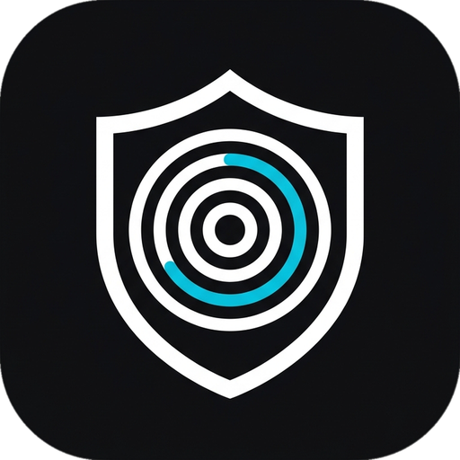
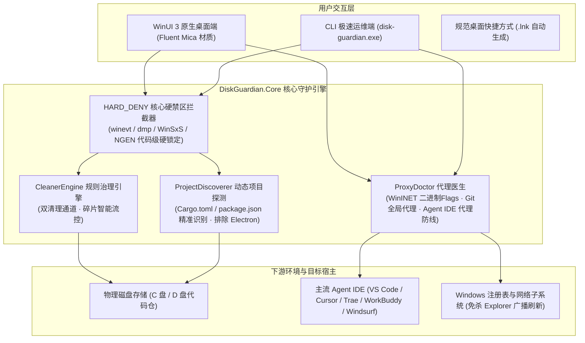

<div align="center">

  

  <h1>DiskGuardian</h1>

  <p><b>Windows 原生高负载开发环境与空间深度守护套件 · 系统级防误杀 · Agent IDE 代理防线</b></p>

  <p>专注攻克 Dism++ 盲区 · 着色器与现代开发缓存精准治理 · 幽灵代理穿透自愈 · 25H2 蓝屏观察期防护</p>

  <p align="center">
    <b>简体中文</b> • <a href="README_EN.md">English</a>
  </p>

  <p align="center">
    <a href="https://github.com/HMuSeaB/disk-guardian/releases/latest"></a>
    <a href="https://dotnet.microsoft.com/"></a>
    <a href="https://github.com/microsoft/microsoft-ui-xaml"></a>
    <a href="https://github.com/HMuSeaB/disk-guardian/releases"></a>
    <a href="LICENSE"></a>
    <a href="#-极简绿色免安装架构"></a>
  </p>

  <p align="center">
    <a href="#-设计背景与定位">设计背景</a> •
    <a href="#-系统架构拓扑">系统架构</a> •
    <a href="#-四大核心守护特性">核心特性</a> •
    <a href="#-快速上手与操作指南">快速上手</a> •
    <a href="#-命令行-cli-矩阵">CLI 矩阵</a> •
    <a href="#-安全硬禁区代码化自测">安全自测</a>
  </p>

</div>

---

## 📖 设计背景与定位

`DiskGuardian`（磁盘守护者）不是另一款随处可见的系统垃圾清理器，它是**为现代软件工程师与高负载 Windows 工作站量身打造的原生系统与空间守护套件**。

传统的系统清理工具（如 Dism++、CCleaner 等）最初设计于传统 Windows 时代，在面对现代开发技术栈与复杂网络环境时暴露出了明显缺陷：
- **清理盲区大**：Dism++ 的规则库专注于 `WinSxS` 与系统更新备份，对庞大的现代开发缓存完全无感——如 NVIDIA `DXCache`/`GLCache`（可达 10~30 GB）、Go 编译缓存、Rust `target`、前端 `node_modules`，往往越清磁盘越告急；
- **误删核心引发反向膨胀与排障灾难**：盲目勾选「.NET 程序集缓存」会导致 NGEN 在后台静默重建引发 CPU 飙升与反吃 4GB+ 空间；误删 Windows 事件日志（`winevt`）或崩溃转储（`MEMORY.DMP` / `dedicateddumpfile.sys`）会导致蓝屏排障证据直接灭失；
- **清理大量临时小文件卡死系统回收站**：把数千个 Shader/Temp 小碎片一次性推入回收站，导致 Windows 资源管理器创建成千上万个 `$I/$R` 节点发生严重假死与索引崩溃；
- **网络代理穿透与 Agent IDE 断网痛点**：代理软件（FlClash、Clash Verge 等）退出或卸载后在 WinINET 留下底层幽灵标记，或 VS Code、Cursor、WorkBuddy、Trae、Windsurf 等开发工具因缺少 `http.proxySupport` 强行走直连，导致自定义海外 AI 模型（DeepSeek、Claude、OpenAI、TokenHarbor）高频遭遇“连接失败”或 10061 拒绝连接。

`DiskGuardian` 纯 C# WinUI 3 原生重写，代码化固化安全硬禁区，补齐盲区，杜绝误杀。

---

## 🏛️ 系统架构拓扑



---

## ✨ 四大核心守护特性

### 1. 🎯 现代开发链专治与子项目精准细化勾选
* **Dism++ 盲区全面覆盖**：自动精准探测系统级 Shader 着色器缓存（DXCache/GLCache）、Go 编译缓存、Playwright 二进制与开发包；
* **Rust target / Node modules 细化展开**：
  * 告别以往“要么全删要么全留”的黑盒机制；
  * 自动逐项统计各个子工程的独立占用（按体积从大到小智能排序，如 `tern (target) 20.5GB` 排在最前）；
  * 每个子工程配备**独立 CheckBox**，支持按需去勾选，**绝不误删当前正在编写调试的核心项目**；
  * 提供一键【定位】按钮，原生调起文件资源管理器秒级核验。

### 2. 🩺 幽灵代理与主流 Agent IDE 代理防线 (ProxyDoctor)
* **WinINET 底层二进制 Flags 取证**：
  * 精准揪出表面 DWORD `ProxyEnable=0` 但 `DefaultConnectionSettings` 二进制第 8 字节仍留有 `0x02` 手动代理标志的幽灵残留；
  * 免重启、**坚决不杀 `explorer.exe`**，通过 Win32 WinINET 原生 API 广播生效；
* **Git 全局代理 (`~/.gitconfig`) 死锁检测**：
  * 探测 `http.proxy` 是否指向未在监听的本地死端口，根治开发者高频遭遇的 `git clone Connection refused (10061)` 绝症；
* **主流 Agent IDE 代理防线一键打通**：
  * 通用覆盖 **VS Code**、**Cursor**、**Trae**、**Windsurf**、**WorkBuddy**、**ZCode** 等；
  * 诊断 `http.proxySupport` 状态，自动识别因 IDE 缺省判定直连导致海外自定义模型（DeepSeek、Claude、OpenAI、TokenHarbor、TokenRouter）断网连接失败的弱点；
  * 支持一键安全注入代理与加固（带自动 `.bak` 备份），重启 IDE 秒级畅通。

### 3. 🛡️ 核心硬禁区代码化锁定 (21 项自测断言 100% 固化)
* **蓝屏观察期防护**：代码级硬编码锁定 `%SystemRoot%\winevt`（事件日志证据链）、`MEMORY.DMP`、`Minidump` 与专用转储文件 `dedicateddumpfile.sys`，即使规则写错或手滑也绝无可能越界误杀；
* **NGEN 与系统核心保护**：阻断 `%SystemRoot%\assembly`（防止清空后后台重建反向吃光磁盘）与 `WinSxS`；
* **严格排除运行时误触**：同级清单识别严格阻断 Electron 运行时内置目录（如 `resources/app`），绝不影响日常办公软件。

### 4. ⚡ 极速双清理通道与绿色便携架构
* **双清理模式分流**：
  * **【直接永久清理 (极速模式)】**：针对 Shader/Temp 等数千个零碎临时文件，跳过系统回收站直接文件系统物理级抹除，绝不阻塞系统回收站；
  * **【移入回收站 (可撤销)】**：用于重要工程与文件，支持两步确认与随时撤销还原；
  * **智能碎片流控**：检测到单次清理文件数 > 500 时，弹窗智能提示分流建议，避免 Windows 回收站假死；
* **极简便携架构**：
  * 原生 Win32 C 启动器（仅 18 KB，零依赖），解压后根目录下仅有 `DiskGuardian.exe`、`rules.json`、专属图标与收纳整洁的 `app/` 依赖库；
  * 彻底废除 `.bat` 临时脚本，主界面右上角原生支持一键在真实桌面创建标准 Windows 快捷方式（`.lnk`）。

---

## 🚀 快速上手与操作指南

### 方式一：桌面图形界面（推荐日常使用）
1. 从 [Releases 页面](https://github.com/HMuSeaB/disk-guardian/releases) 下载 `disk-guardian-winui3-win-x64.zip`；
2. 解压至任意目录，直接双击根目录的 **`DiskGuardian.exe`**；
3. **创建桌面快捷方式**：在界面右上角点击【创建桌面快捷方式】，系统将自动在桌面生成带专属图标的标准快捷方式；
4. **一键打通 IDE 代理**：在仪表盘点击【加固 Agent IDE 代理】，一键让 VS Code / Cursor / WorkBuddy 的自定义模型走通代理；
5. **空间规则清理**：切至「空间规则清理」，勾选需要清理的规则，点击【开始扫描勾选项】，展开项目子项确认后执行清理。

### 方式二：命令行运维端 (CLI)
适合自动化脚本、日常运维与快速体检：
```powershell
# 1. 运行 21 项核心安全硬禁区自测
disk-guardian --check-rules

# 2. 检查网络系统代理、Git 全局代理与 Agent IDE 代理防线
disk-guardian --check-proxy

# 3. 一键加固已安装的所有 Agent IDE 代理支持 (自动绑定活跃代理)
disk-guardian --harden-ide-proxy

# 4. 安全清洗幽灵代理残留并广播生效 (绝不杀 explorer.exe)
disk-guardian --fix-proxy

# 5. 在用户桌面创建规范快捷方式
disk-guardian --create-shortcut

# 6. 安全防卡死清空回收站
disk-guardian --purge
```

---

## 📊 命令行 CLI 参数矩阵

| 参数标志 | 模式说明 | 行为说明 |
|---|---|---|
| `--check-rules` | 核心安全自检 | 运行 18 项 `HARD_DENY` 硬断言 + 3 项项目发现断言，出现任何漏洞直接 fail-fast 阻断 |
| `--check-proxy` | 网络与代理体检 | 结构化输出 WinINET 标志位、回环端口连通性延迟、Git 代理、Agent IDE 代理配置 |
| `--harden-ide-proxy`| Agent IDE 加固 | 扫描 VS Code/Cursor/Trae/WorkBuddy 等，自动注入 `http.proxySupport` 与活跃代理 |
| `--fix-proxy` | 幽灵代理安全清洗 | 自动备份注册表，清洗 DefaultConnectionSettings 手动位，WinINet 广播生效 |
| `--create-shortcut` | 快捷方式生成 | 动态解析当前桌面路径，调用 Win32 原生 COM 接口生成 `DiskGuardian.lnk` |
| `--level <1/2/3>` | 清理安全级别 | 默认 1（纯快速安全缓存）；2 级需重下构建产物；3 级需确认关键数据 |
| `--apply` | 执行清理操作 | 默认安全移入回收站（两步可撤销） |
| `--purge` | 安全清空回收站 | 分批次安全物理清空 `$Recycle.Bin`，单文件容错，跳过锁定项，绝不卡死 |

---

## 🔒 安全硬禁区代码化自测

在工程设计中，安全禁区**绝不依赖外部 json 规则**，全部固化在 C# 静态断言库中。每次启动自检均会执行完整断言链：

```text
=== disk-guardian C# 核心自检 | mode=check | level<=1 ===
--- HARD_DENY self-test (18 条安全断言) ---
[SELF-TEST PASS] blocked  C:\windows\WinSxS                                  删它会连带删掉受保护项 c:\windows\winsxs
[SELF-TEST PASS] blocked  C:\windows\assembly                                删它会连带删掉受保护项 c:\windows\assembly
[SELF-TEST PASS] blocked  C:\windows\winevt\Logs                             位于硬禁区 c:\windows\winevt 之内
[SELF-TEST PASS] blocked  C:\windows\System32                                删它会连带删掉受保护项 c:\windows\system32
[SELF-TEST PASS] blocked  C:\Users\36230\AppData\Local\CrashDumps            删它会连带删掉受保护项 c:\users\36230\appdata\local\crashdumps
[SELF-TEST PASS] blocked  D:\dedicateddumpfile.sys                           命中系统关键文件名保护
...
--- ProjectDiscoverer self-test (3 条发现断言) ---
[SELF-TEST PASS] discover: 项目合法依赖被成功发现
[SELF-TEST PASS] discover: Electron 运行时应用被严格排除
[SELF-TEST PASS] discover: 无包清单目录被安全跳过
--- end self-test ---

ALL 21 SELF-TEST ASSERTIONS PASSED! 核心安全与防误杀机制运行正常。
```

---

## 🛠️ 本地构建与打包

项目使用标准 .NET 9.0 SDK 与原生 MinGW/GCC 构建极简绿色包：
```powershell
# 执行一键构建与打包流水线 (生成带图标绿色便携 ZIP)
powershell -ExecutionPolicy Bypass -File build_release.ps1
```
*构建产物将输出至 `dist/` 目录。*

---

## 📄 开源许可证

本项目基于 [MIT 许可证](LICENSE) 开源。欢迎提交 Issue 与 Pull Request 共同完善开发者清理规则与安全防线！
