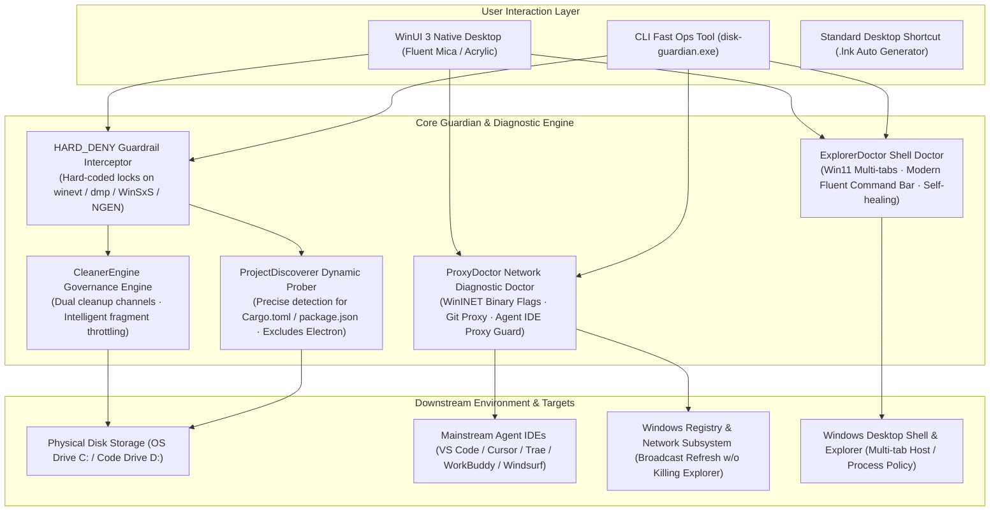

<div align="center">

  

  <h1>DiskGuardian</h1>

  <p><b>Windows Native Workspace & System Deep Guardian · Blue-Screen Incident Safe · Agent IDE Proxy Doctor</b></p>

  <p>Covering Dism++ blind spots · Shader & Dev cache itemized governance · Ghost proxy penetration · 25H2 BSOD observation protection</p>

  <p align="center">
    <a href="README.md">简体中文</a> • <b>English</b>
  </p>

  <p align="center">
    <a href="https://github.com/HMuSeaB/disk-guardian/releases/latest"></a>
    <a href="https://dotnet.microsoft.com/"></a>
    <a href="https://github.com/microsoft/microsoft-ui-xaml"></a>
    <a href="https://github.com/HMuSeaB/disk-guardian/releases"></a>
    <a href="LICENSE"></a>
    <a href="#-portable-zero-dependency-architecture"></a>
  </p>

  <p align="center">
    <a href="#-design-background--philosophy">Background</a> •
    <a href="#-system-architecture">Architecture</a> •
    <a href="#-core-features">Features</a> •
    <a href="#-quick-start">Quick Start</a> •
    <a href="#-cli-reference">CLI Reference</a> •
    <a href="#-hard-coded-safety-self-tests">Safety Self-tests</a>
  </p>

</div>

---

## 📖 Design Background & Philosophy

`DiskGuardian` is not just another generic junk cleaner. It is a **native system and storage guardian toolkit tailored for modern software developers and high-workload Windows workstations**.

Traditional Windows cleanup utilities (such as Dism++ or CCleaner) were built for legacy system environments and exhibit significant drawbacks when handling modern developer stacks and complex network proxies:
- **Major Blindspots**: Traditional cleaners focus almost exclusively on `WinSxS` and Windows Update backups, remaining completely oblivious to massive modern developer caches—such as NVIDIA `DXCache`/`GLCache` (often 10~30 GB), Go build caches, Rust `target` outputs, and `node_modules`;
- **Critical Deletions Triggering Space Re-consumption**: Blindly wiping the ".NET Assembly Cache" triggers NGEN background compilation that can consume 4GB+ disk space and cause sustained CPU spikes. Deleting event logs (`winevt`) or crash dumps destroys vital post-incident BSOD analysis evidence;
- **Recycle Bin Freezes on Thousands of Small Files**: Pushing thousands of temporary shader/temp files into the Windows Recycle Bin causes Shell API freezes and `$I/$R` index bloating;
- **Ghost Proxy Conflicts & Agent IDE Disconnections**: Proxy software (FlClash, Clash Verge, etc.) often leaves behind stale binary flags in WinINET upon exit. Meanwhile, Agent IDEs (VS Code, Cursor, WorkBuddy, Trae, Windsurf) default to direct connections in the absence of `http.proxySupport`, causing custom AI model requests (DeepSeek, Claude, OpenAI, TokenHarbor) to fail with connection errors or 10061 connection refused.

`DiskGuardian` is rewritten in pure C# with WinUI 3, enforcing hard-coded safety guardrails, eliminating blindspots, and ensuring zero accidental deletions.

---

## 🏛️ System Architecture



---

## ✨ Core Features

### 1. 🎯 Modern Dev-chain Cleaning & Itemized Project Sub-options
* **Comprehensive Coverage of Dism++ Blindspots**: Automatically detects system-level Shader caches (DXCache/GLCache), Go build caches, Playwright binaries, and package manager caches;
* **Itemized Rust target & Node modules Expansion**:
  * Eliminates the traditional "all-or-nothing" deletion dilemma;
  * Automatically calculates independent sizes for discovered projects and sorts them in descending order (e.g., largest project target listed first);
  * Each project comes with an **independent CheckBox**, allowing developers to uncheck active projects and **safely preserve compilation caches for projects currently under development**;
  * Features a one-click **Locate** button that invokes Windows Explorer to verify project directories instantly.

### 2. 🩺 Ghost Proxy & Mainstream Agent IDE Proxy Doctor (ProxyDoctor)
* **WinINET Binary Flags Forensics**:
  * Accurately detects ghost proxies where DWORD `ProxyEnable=0` on the surface, but the 8th byte in `DefaultConnectionSettings` still contains the `0x02` manual proxy flag;
  * Refreshes system network settings via native WinINET APIs **without restarting and without killing `explorer.exe`**;
* **Git Global Proxy (`~/.gitconfig`) Deadlock Detection**:
  * Detects if `http.proxy` points to an unmonitored dead loopback port, resolving terminal `git clone Connection refused (10061)` errors;
* **Universal Agent IDE Proxy Hardening**:
  * Out-of-the-box support for **VS Code**, **Cursor**, **Trae**, **Windsurf**, **WorkBuddy**, and **ZCode**;
  * Diagnoses `http.proxySupport` status to identify why custom overseas models (DeepSeek, Claude, OpenAI, TokenHarbor) fail due to fallback direct connections;
  * One-click hardening automatically injects proxy configurations with automatic `.bak` backups.

### 3. 🗂️ Desktop Shell & Windows Explorer Health Doctor (ExplorerDoctor)
* **Eliminate Win11 Tab Loss & Win10 Legacy Ribbon Fallbacks**:
  * Automatically detects whether registry `Shell Extensions\Blocked` maliciously suppresses the Windows 11 modern Fluent Command Bar (`CLSID {e2bf9676-...}`);
  * Deeply inspects `SeparateProcess` conflicts (launching folder windows in a separate process) that cause multi-tab host detachment;
  * Identifies session elevation context and alerts against Win32 legacy fallbacks under Administrator privileges;
* **One-Click Safe Restoration to Win11 Native Shell**:
  * Restores modern command bars and resets process isolation policies with a single click, broadcasting refresh events via Win32 APIs;
  * Strictly adheres to Windows Desktop Safety Rules: **Never violently kills `explorer.exe`**, protecting DeskBox and third-party widgets from collapse.

### 4. 🛡️ Hard-coded Safety Guardrails (21 Self-test Assertions at 100% PASS)
* **Blue-Screen Observation Period Protection**: Code-level hard locks protect `%SystemRoot%\winevt` (event log chain of custody), `MEMORY.DMP`, `Minidump`, and dedicated dump files (`dedicateddumpfile.sys`);
* **NGEN & Core System Protection**: Prevents deletions in `%SystemRoot%\assembly` (protecting against NGEN background rebuilds that consume 4GB+ disk space) and `WinSxS`;
* **Runtime Exclusion**: Peer-manifest checks strictly block Electron runtime directories (`resources/app`).

### 5. ⚡ Dual Cleanup Channels & Clean Portable Architecture
* **Dual Cleanup Modes**:
  * **Direct Permanent Cleanup (Fast Channel)**: Bypasses the Recycle Bin for thousands of tiny cache fragments (Shader/Temp) using filesystem-level deletion;
  * **Move to Recycle Bin (Undoable Channel)**: Two-step confirmation for critical project dependencies;
  * **Intelligent Fragment Throttling**: Automatically suggests the fast channel when fragment count exceeds 500 items, preventing Recycle Bin freezes;
* **Clean Portable Setup**:
  * 18 KB native Win32 C launcher (`DiskGuardian.exe`), free of terminal black-box flashes;
  * Standard `.lnk` desktop shortcut generation via native COM interface (`WScript.Shell`).

---

## 🚀 Quick Start

### Graphical User Interface (Recommended)
1. Download `disk-guardian-winui3-win-x64.zip` from [Releases](https://github.com/HMuSeaB/disk-guardian/releases);
2. Extract to any directory and double-click **`DiskGuardian.exe`**;
3. Click **Create Desktop Shortcut** in the top-right header to create a standard Windows shortcut on your desktop;
4. Click **Harden Agent IDE Proxy** on the Dashboard to resolve custom model connection issues across VS Code / Cursor / WorkBuddy;
5. Switch to **Space Rules Cleanup**, scan selected items, expand itemized project sub-options, and safely clean up.

### Command Line Interface (CLI)
```powershell
# 1. Run all 21 hard-coded safety guardrail self-tests
disk-guardian --check-rules

# 2. Check system proxy, Git proxy, and Agent IDE proxy statuses
disk-guardian --check-proxy

# 3. Harden all installed Agent IDEs with active proxy support
disk-guardian --harden-ide-proxy

# 4. Safely clean ghost proxy registry conflicts (w/o killing explorer.exe)
disk-guardian --fix-proxy

# 5. One-click switch to Pure Direct mode (quit background tray proxies, reset registry to 0, flush DNS for gaming)
disk-guardian --direct

# 6. Check desktop shell & Windows Explorer health (detect Win11 tab blocking)
disk-guardian --check-shell

# 6. One-click restore Windows 11 native multi-tab Explorer shell
disk-guardian --fix-shell

# 7. Generate a standard Windows desktop shortcut
disk-guardian --create-shortcut

# 8. Safely empty the Recycle Bin with batch error handling
disk-guardian --purge
```

---

## 📄 License

This project is open-sourced under the [MIT License](LICENSE).

