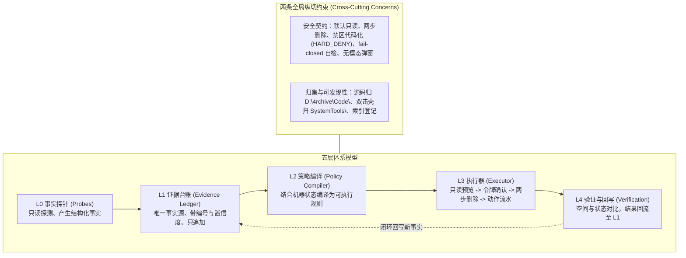

# 体系设计：证据台账 (Evidence Ledger Architecture)

---

## 1. 核心判据：什么才算「一个工程体系」

治理清理脚本碎片化与经验断链的核心痛点，正是 `SystemTools\索引.md` 中早已指出的：
> **脚本每次临时造、散在会话工作区、结论留在聊天里、下次重来。**

因此，证据台账体系必须严格满足以下三条硬判据：

| 判据 | 含义 | 对应落地 |
| :--- | :--- | :--- |
| **事实有唯一出处** | 每条结论均可追溯至具体的探测事实、物理机事故与确切时间 | 参见 `docs/incidents/2026-11-04-bsod-incident-and-rules.md` |
| **决策可编译** | 清理与防护策略由事实派生，而非凭空臆想或人工盲写 | 禁区由事故派生；`rules.json` 规则带 provenance |
| **动作可回写** | 执行动作产生审计流水，前后状态对比回写，下一轮自动受益 | `actions.jsonl` 流水落盘，前后可用空间增量入账 |

---

## 2. 五层分层模型 + 两条全局纵切



### 层级硬契约

- **L0 (事实探针)**：本机或外部数据 → 结构化事实。只读、不产生副作用、带 `source`、`observed_at`、`confidence`。
- **L1 (证据台账)**：事实记录 → 带编号条目。唯一事实源，只追加不覆盖，过期条目标注 `superseded`。
- **L2 (策略编译)**：台账条目 + **机器状态 (Machine State)** → 可执行策略。每条策略附带 `provenance`；禁区在代码不在数据。
- **L3 (执行器)**：策略 → 副作用执行。遵循统一安全规范：`preview → confirm → act → journal`。
- **L4 (验证与回写)**：前后状态对比 → 闭环回流至 L1 成为新事实。

---

## 3. 机器状态 (Machine State) 动态控制

机器状态是 L2 策略编译的关键输入。规则的宽严程度必须感知机器所处阶段：

```text
               ┌───────────────────────────────┐
               │    机器状态 (Machine State)    │
               └───────────────┬───────────────┘
                               │
         ┌─────────────────────┼─────────────────────┐
         ▼                     ▼                     ▼
     【排障中】             【观察期】              【正常】
   全面冻结清理           封锁 dmp/还原点/WinSxS    按常规 Level 清理
   留存全部现场           保护排障证据与回滚能力    永久禁区仍受限
```

- **当前状态**：`OBSERVATION`（25H2 蓝屏排障后观察期）。
- **禁区控制**：在观察期内，即使是常规清理器认为可以清理的转储和还原点，也必须坚决封锁。

---

## 4. 外部组件定位 (REA、Dism++、wintuner)

层间依托契约而非强耦合，外部工具均为各层的可插拔组件：

| 组件 | 所属层级 | 定位与契约 |
| :--- | :--- | :--- |
| **REA (可选探针)** | L0 探针插槽 | 动态/闭源行为取证（如探查未公开 API 调用栈）。输出带 evidence + limitations，不改变上层编译逻辑。 |
| **Dism++ Data.xml** | L0 数据源 | 提取其 71 条规则中的路径事实作为输入，不整份复制进仓库。 |
| **Dism.exe (系统命令)** | L3 可选后端 | 驱动官方组件清理命令，观察期禁用。 |
| **wintuner / DOUZHANZHE** | L3 / L0 兄弟工程 | 注册表与系统调优；各自独立，通过契约对齐，**严禁合并仓库**。 |

---

## 5. 落地规划阶段

1. **阶段 0（台账成型）**：梳理事故与逆向事实，建立标准台账条目（已由 `docs/incidents/` 与 `docs/research/` 奠定）。
2. **阶段 1（策略溯源）**：`rules.json` 与 `HARD_DENY` 常量建立出处索引编号。
3. **阶段 2（机器状态）**：引入 `state.json`，清理器感知观察期动态调整拦截策略。
4. **阶段 3（探针契约）**：标准化 L0 输出格式。
5. **阶段 4（执行器契约）**：统一 `preview → confirm → act → journal` 审计标准。

